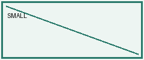
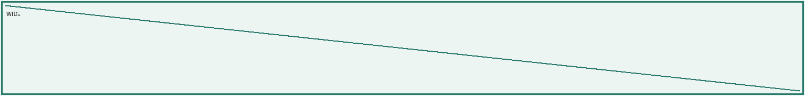
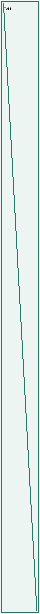

# 原创综合回归样本

固定种子 20231029，A4、150 DPI、40 像素字号。每项以 T 编号；E 项为故意错误。

## T01 基础 Markdown

预期：标题层级可辨；强调、删除线、引用与链接保留语义或明确报告替代；嵌套列表保持层级，任务状态不丢失。

### 三级标题

普通段落：**加粗重点**、*倾斜重点*、~~已撤销结论~~、`inline code`。

> 数据仅用于软件排版验证。

- 一级项目
  - 二级项目
    - 三级项目
- [x] 已完成实验
- [ ] 待复查实验

1. 步骤一
2. 步骤二：[示例链接](https://example.org)

---

## T02 数学表达

预期：公式二维排版，基线一致，不与正文或下一行重叠；嵌套方框完整。

行内 $a_i^2+\frac{b}{\sqrt{c}}$ 后面接正常中文，下一句仍然可读。

$$\sum_{k=1}^{n} k=\frac{n(n+1)}{2},\quad \int_0^1 x^2\,dx=\frac13,\quad \lim_{x\to0}\frac{\sin x}{x}=1$$

$$M=\begin{pmatrix}1&2\\3&4\end{pmatrix},\quad f(x)=\begin{cases}x^2,&x\ge0\\-x,&x<0\end{cases}$$

$$\begin{aligned}u&=\sqrt{1+t^2}\\v&=\boxed{\frac{1}{\boxed{1+t}}}\end{aligned}$$

## T03 混合表格

预期：中文英文、公式、转义竖线与空格保持；长单元格换行，边框不压字。

| 项目 | English / 公式 | 说明 |
|---|---|---|
| 中文 | $\frac{1}{1+x^2}$ | 长说明用于观察换行，自动换行不能丢掉最后几个字符：结束。 |
| pipe | a\|b | $|x|$ |
| 空单元格 | | |

## T04 字符图与混合线型

预期：横轴实线，辅助边界虚线；零点空心，极点叉号；交点各方向线型独立。

```polezero
       ↑ Im
   ○   │   ×
┄┄┄┄┄┄┄┼┄┄┄┄┄┄
       │
───────┼────────→ Re
       ┆
       ┆
```

```constellation
     ┆     ↑     ┆
  ×  ┆  ×  │  ×  ┆  ×
┄┄┄┄┄┼┄┄┄┄┄┼┄┄┄┄┄┼┄┄┄┄
─────┼─────┼─────┼────→ I
  ×  ┆  ×  │  ×  ┆  ×
```

## T05 本地图片

预期：解析相对路径，图片完整等比显示，图注紧跟图片；横图、竖图不能裁切。







## T06 长词与特殊字符

预期：超长英文可折行；特殊符号完整或明确报告缺字，不越过右页边。

ABCDEFGHIJKLMNOPQRSTUVWXYZabcdefghijklmnopqrstuvwxyz0123456789ABCDEFGHIJKLMNOPQRSTUVWXYZabcdefghijklmnopqrstuvwxyz0123456789

符号：α β Ω ∞ ≈ ± ≤ ≥ → ← × ○ ℃ ℏ ①。

## T07 超宽公式

预期：整式等比缩放并报告缩放比例，不静默裁切；过小应提示拆分公式。

$$W=\frac{a_1+b_1}{c_1}+\frac{a_2+b_2}{c_2}+\frac{a_3+b_3}{c_3}+\frac{a_4+b_4}{c_4}+\frac{a_5+b_5}{c_5}+\frac{a_6+b_6}{c_6}+\frac{a_7+b_7}{c_7}+\frac{a_8+b_8}{c_8}+\frac{a_9+b_9}{c_9}+\frac{a_{10}+b_{10}}{c_{10}}$$

## T08 超宽表格

预期：列数过多时报告密度问题，保留全部内容；不能悄悄裁掉最后一列。

|列1|列2|列3|列4|列5|列6|列7|列8|列9|列10|列11|列12|列13|列14|
|---|---|---|---|---|---|---|---|---|---|---|---|---|---|
|值1|值2|值3|值4|值5|值6|值7|值8|值9|值10|值11|值12|值13|值14|

## T09 跨页长表格

预期：80 行编号 001—080 各出现一次，跨页重复表头，不丢行。

| 编号 | 测量值 | 备注 |
|---|---|---|
| 001 | 0.1 | 原创记录，序号 001。 |
| 002 | 0.2 | 原创记录，序号 002。 |
| 003 | 0.3 | 原创记录，序号 003。 |
| 004 | 0.4 | 原创记录，序号 004。 |
| 005 | 0.5 | 原创记录，序号 005。 |
| 006 | 0.6 | 原创记录，序号 006。 |
| 007 | 0.7 | 原创记录，序号 007。 |
| 008 | 0.8 | 原创记录，序号 008。 |
| 009 | 0.9 | 原创记录，序号 009。 |
| 010 | 1.0 | 原创记录，序号 010。 |
| 011 | 1.1 | 原创记录，序号 011。 |
| 012 | 1.2 | 原创记录，序号 012。 |
| 013 | 1.3 | 原创记录，序号 013。 |
| 014 | 1.4 | 原创记录，序号 014。 |
| 015 | 1.5 | 原创记录，序号 015。 |
| 016 | 1.6 | 原创记录，序号 016。 |
| 017 | 1.7 | 原创记录，序号 017。 |
| 018 | 1.8 | 原创记录，序号 018。 |
| 019 | 1.9 | 原创记录，序号 019。 |
| 020 | 2.0 | 原创记录，序号 020。 |
| 021 | 2.1 | 原创记录，序号 021。 |
| 022 | 2.2 | 原创记录，序号 022。 |
| 023 | 2.3 | 原创记录，序号 023。 |
| 024 | 2.4 | 原创记录，序号 024。 |
| 025 | 2.5 | 原创记录，序号 025。 |
| 026 | 2.6 | 原创记录，序号 026。 |
| 027 | 2.7 | 原创记录，序号 027。 |
| 028 | 2.8 | 原创记录，序号 028。 |
| 029 | 2.9 | 原创记录，序号 029。 |
| 030 | 3.0 | 原创记录，序号 030。 |
| 031 | 3.1 | 原创记录，序号 031。 |
| 032 | 3.2 | 原创记录，序号 032。 |
| 033 | 3.3 | 原创记录，序号 033。 |
| 034 | 3.4 | 原创记录，序号 034。 |
| 035 | 3.5 | 原创记录，序号 035。 |
| 036 | 3.6 | 原创记录，序号 036。 |
| 037 | 3.7 | 原创记录，序号 037。 |
| 038 | 3.8 | 原创记录，序号 038。 |
| 039 | 3.9 | 原创记录，序号 039。 |
| 040 | 4.0 | 原创记录，序号 040。 |
| 041 | 4.1 | 原创记录，序号 041。 |
| 042 | 4.2 | 原创记录，序号 042。 |
| 043 | 4.3 | 原创记录，序号 043。 |
| 044 | 4.4 | 原创记录，序号 044。 |
| 045 | 4.5 | 原创记录，序号 045。 |
| 046 | 4.6 | 原创记录，序号 046。 |
| 047 | 4.7 | 原创记录，序号 047。 |
| 048 | 4.8 | 原创记录，序号 048。 |
| 049 | 4.9 | 原创记录，序号 049。 |
| 050 | 5.0 | 原创记录，序号 050。 |
| 051 | 5.1 | 原创记录，序号 051。 |
| 052 | 5.2 | 原创记录，序号 052。 |
| 053 | 5.3 | 原创记录，序号 053。 |
| 054 | 5.4 | 原创记录，序号 054。 |
| 055 | 5.5 | 原创记录，序号 055。 |
| 056 | 5.6 | 原创记录，序号 056。 |
| 057 | 5.7 | 原创记录，序号 057。 |
| 058 | 5.8 | 原创记录，序号 058。 |
| 059 | 5.9 | 原创记录，序号 059。 |
| 060 | 6.0 | 原创记录，序号 060。 |
| 061 | 6.1 | 原创记录，序号 061。 |
| 062 | 6.2 | 原创记录，序号 062。 |
| 063 | 6.3 | 原创记录，序号 063。 |
| 064 | 6.4 | 原创记录，序号 064。 |
| 065 | 6.5 | 原创记录，序号 065。 |
| 066 | 6.6 | 原创记录，序号 066。 |
| 067 | 6.7 | 原创记录，序号 067。 |
| 068 | 6.8 | 原创记录，序号 068。 |
| 069 | 6.9 | 原创记录，序号 069。 |
| 070 | 7.0 | 原创记录，序号 070。 |
| 071 | 7.1 | 原创记录，序号 071。 |
| 072 | 7.2 | 原创记录，序号 072。 |
| 073 | 7.3 | 原创记录，序号 073。 |
| 074 | 7.4 | 原创记录，序号 074。 |
| 075 | 7.5 | 原创记录，序号 075。 |
| 076 | 7.6 | 原创记录，序号 076。 |
| 077 | 7.7 | 原创记录，序号 077。 |
| 078 | 7.8 | 原创记录，序号 078。 |
| 079 | 7.9 | 原创记录，序号 079。 |
| 080 | 8.0 | 原创记录，序号 080。 |

## T10 超高字符图与分页

预期：超高图等比缩放并提示；标题不孤立在页底。

```diagram
↑ y
│
│
│
│
│
│
│
│
│
│
│
│
│
│
│
│
│
│
│
│
│
│
│
│
│
│
│
│
│
│
│
│
│
│
│
│
│
│
│
│
│
│
│
│
│
│
│
│
│
│
│
│
│
│
│
└────→ x
```

## T11 精确坐标描述

预期：采用安全 JSON，不执行代码；坐标轴实线，非零门限虚线，空心零点与极点位置准确。

```plot
{"xlim":[-4,4],"ylim":[-3,3],"axes":true,"points":[{"x":-2,"y":1,"kind":"zero","label":"z1"},{"x":2,"y":-1,"kind":"pole","label":"p1"},{"x":1,"y":1,"kind":"star"}],"lines":[{"from":[-2,-3],"to":[-2,3],"style":"dashed"},{"from":[-4,2],"to":[4,2],"style":"dashed"}],"labels":[{"x":0.2,"y":2.7,"text":"Q"},{"x":3.6,"y":-0.3,"text":"I"}]}
```

## E01 故意错误：公式

预期：错误定位到本章节和公式行；保留原文替代，不能画成正确答案。

$$\unsupportedcommand{x}$$

## E02 故意错误：缺失图片

预期：显示缺失文件的具体路径、行号与替代文字。


## E03 故意不支持：HTML

预期：报告不支持 HTML 布局，保留源文字；不执行 HTML。

<div style="color:red">故意不支持的 HTML 样例</div>

## E04 故意错误：坐标图配置

预期：不执行对象中的代码；报告非法配置而不是生成错误图。

```plot
{"xlim":[0,0],"run":"print('NEVER EXECUTE')"}
```


<!-- pagebreak -->
## T12 内容列宽与短表达

预期：序号列较窄，说明列较宽；英文单词、12.50 mV、1.25e-3 A 和数字 123.456 尽量整体换行，最后的“结束标记”不丢失。

| 编号 | 测量 | 说明 |
|---|---|---|
| 01 | 12.50 mV | reconstruction sample 的中文长说明，自动分配更多空间，结束标记。 |
| 02 | 1.25e-3 A | 数字 123.456 与 unit test 均保持顺序。 |

## T13 公式安全分行

预期：只在顶层运算符前分行，拼回源字符串后完全相同；分数、根式、括号、上下标和矩阵内部不拆。

$$R=\frac{a_1+b_1}{c_1-d_1}+\frac{a_2+b_2}{c_2-d_2}+\frac{a_3+b_3}{c_3-d_3}+\frac{a_4+b_4}{c_4-d_4}+\sqrt{u_1+v_1}+(p_1-q_1)+t_{i+1}+\frac{a_5+b_5}{c_5-d_5}+\frac{a_6+b_6}{c_6-d_6}+\frac{a_7+b_7}{c_7-d_7}$$

预期：下式的大分组中没有可靠断点，允许整体缩放，但必须报告不能分行的原因与比例。

$$\left(\frac{a_1+b_1}{c_1}+\frac{a_2+b_2}{c_2}+\frac{a_3+b_3}{c_3}+\frac{a_4+b_4}{c_4}+\frac{a_5+b_5}{c_5}+\frac{a_6+b_6}{c_6}+\frac{a_7+b_7}{c_7}+\frac{a_8+b_8}{c_8}+\frac{a_9+b_9}{c_9}+\frac{a_{10}+b_{10}}{c_{10}}\right)$$

<!-- keep-next -->
### T14 标题与显式图注组合


<!-- caption: 显式图注替代图片替代文字，标题、图、图注应在同页。 -->

预期：上面的 keep-next 只绑定之后两块；普通说明段落不自动绑定。下面两张连续图片及各自图注应保持各自组合，不出现孤立图注。


<!-- caption: 连续图片一。 -->

<!-- caption: 连续图片二。 -->

<!-- pagebreak -->
## T15 超高组合稳定降级

预期：两张高图组合超过一页，只给出明确降级提示并按顺序分页，保留两张完整图和两个图注；末尾连续分页标记不生成空白页。

<!-- keep-start -->

<!-- caption: 超高图一，边框完整。 -->

<!-- caption: 超高图二，边框完整。 -->
<!-- keep-end -->
<!-- pagebreak -->
<!-- pagebreak -->
